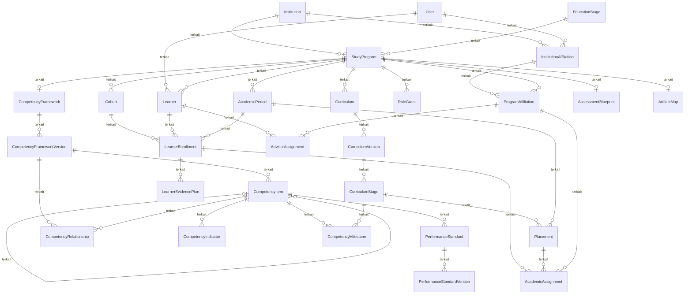
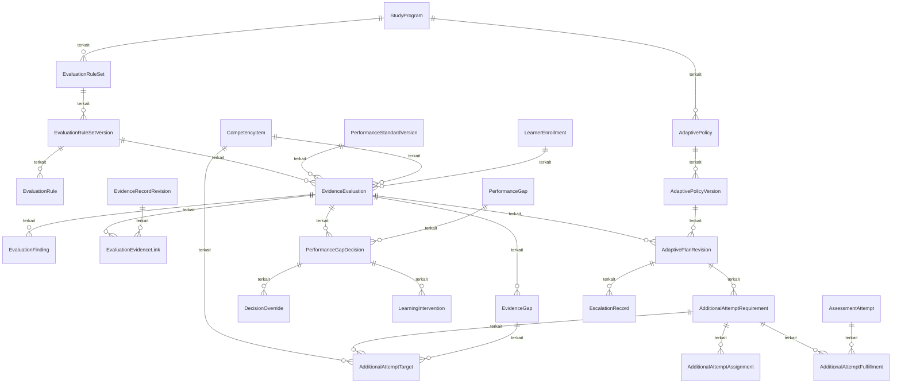
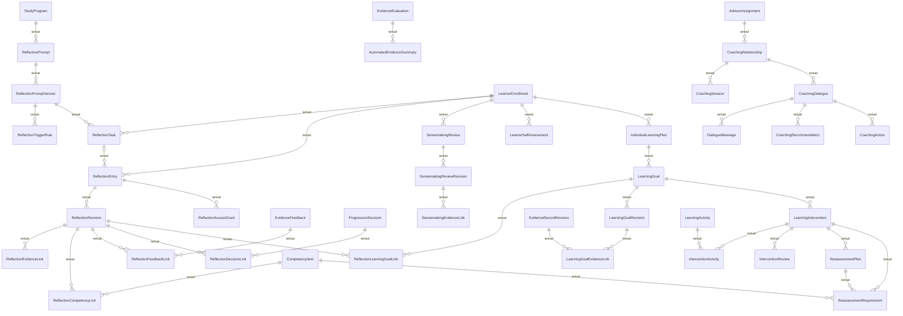
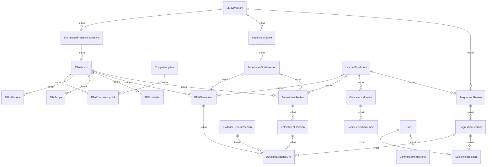
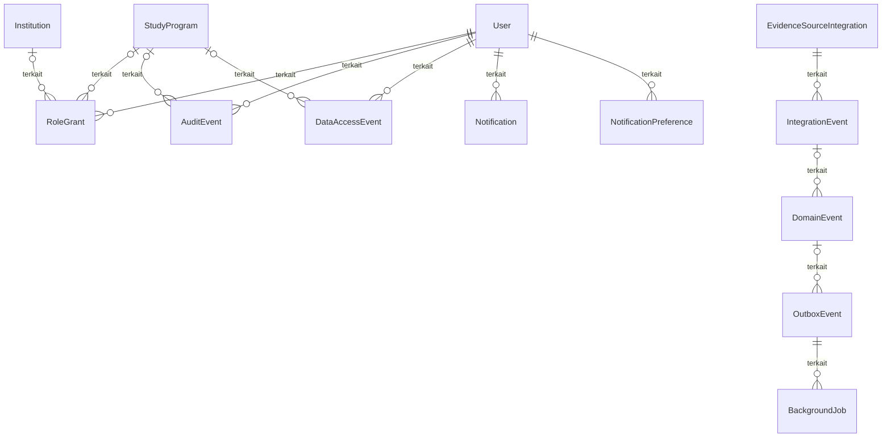

# ERD logis

Setiap diagram menampilkan satu area kerja. Hubungan lintas area menggunakan nama entitas yang sama. Kardinalitas menjelaskan jalur rancangan dan validasi tambahan dicatat dalam skema.

## Akademik dan kompetensi

## Asesmen, sumber, peta dan bukti

```mermaid
erDiagram
    AssessmentBlueprint ||--o{ AssessmentBlueprintVersion : terkait
    AssessmentBlueprintVersion ||--o{ BlueprintItem : terkait
    AssessmentMethod ||--o{ BlueprintItem : terkait
    AssessmentMethod ||--o{ AssessmentEvent : terkait
    BlueprintItem ||--o{ BlueprintItemCompetency : terkait
    BlueprintItem ||--o{ AssessmentSamplingRule : terkait
    BlueprintItem ||--o{ AssessmentEvent : terkait
    BlueprintItem ||--o{ EvidenceRequirementOrigin : terkait
    CompetencyItem ||--o{ BlueprintItemCompetency : terkait
    CompetencyIndicator o|--o{ BlueprintItemCompetency : terkait
    AssessmentEvent ||--o{ AssessmentParticipation : terkait
    LearnerEnrollment ||--o{ AssessmentParticipation : terkait
    AssessmentParticipation ||--o{ AssessmentAttempt : terkait
    AssessmentAttempt ||--o{ AssessmentResult : terkait
    AssessmentResult ||--o{ AssessmentResultComponent : terkait
    StudyProgram ||--o{ EvidenceSource : terkait
    StudyProgram ||--o{ EvidenceType : terkait
    EvidenceSource ||--o{ EvidenceSourceCapability : terkait
    EvidenceSource ||--o{ EvidenceSourceCompetency : terkait
    EvidenceSource ||--o{ EvidenceSourceIntegration : terkait
    EvidenceSource ||--o{ EvidenceSourceMapping : terkait
    EvidenceSource ||--o{ EvidenceRequirementSource : terkait
    EvidenceSource ||--o{ EvidenceRecord : terkait
    EvidenceType ||--o{ EvidenceSourceCapability : terkait
    EvidenceType ||--o{ EvidenceRecord : terkait
    CompetencyItem ||--o{ EvidenceSourceCompetency : terkait
    ArtifactMap ||--o{ ArtifactMapVersion : terkait
    ArtifactMapVersion ||--o{ ArtifactMapItem : terkait
    ArtifactMapVersion ||--o{ LearnerEvidencePlan : terkait
    ArtifactMapItem ||--o{ ArtifactMapItemCompetency : terkait
    ArtifactMapItem ||--o{ EvidenceRequirementTemplate : terkait
    CompetencyItem ||--o{ ArtifactMapItemCompetency : terkait
    CompetencyItem ||--o{ EvidenceRequirementCompetency : terkait
    EvidenceRequirementTemplate ||--o{ EvidenceRequirementCompetency : terkait
    EvidenceRequirementTemplate ||--o{ EvidenceRequirementOrigin : terkait
    EvidenceRequirementTemplate ||--o{ EvidenceRequirementSource : terkait
    EvidenceRequirementTemplate ||--o{ LearnerEvidenceRequirement : terkait
    FulfillmentRule ||--o{ FulfillmentRuleVersion : terkait
    FulfillmentRuleVersion ||--o{ EvidenceRequirementTemplate : terkait
    FulfillmentRuleVersion ||--o{ RequirementRevision : terkait
    LearnerEvidencePlan ||--o{ LearnerEvidenceRequirement : terkait
    LearnerEvidencePlan ||--o{ AdaptivePlanRevision : terkait
    LearnerEvidenceRequirement ||--o{ RequirementRevision : terkait
    LearnerEvidenceRequirement ||--o{ RequirementEvidenceLink : terkait
    LearnerEnrollment ||--o{ EvidenceRecord : terkait
    EvidenceRecord ||--o{ EvidenceRecordRevision : terkait
    EvidenceRecord ||--o{ RequirementEvidenceLink : terkait
    EvidenceRecord ||--o{ ReflectionEvidenceLink : terkait
    EvidenceRecord ||--o{ SensemakingEvidenceLink : terkait
    EvidenceRecordRevision ||--o{ EvidenceArtifact : terkait
    EvidenceRecordRevision ||--o{ EvidenceCompetencyLink : terkait
    EvidenceRecordRevision ||--o{ EvidenceObservation : terkait
    EvidenceRecordRevision ||--o{ EvidenceScore : terkait
    EvidenceRecordRevision ||--o{ EvidenceFeedback : terkait
    EvidenceRecordRevision ||--o{ EvidenceVerification : terkait
    EvidenceRecordRevision ||--o{ EvidenceProvenance : terkait
    EvidenceRecordRevision ||--o{ EvidenceContext : terkait
    AssessmentAttempt o|--o{ EvidenceProvenance : terkait
    CompetencyItem ||--o{ EvidenceCompetencyLink : terkait
    CompetencyIndicator o|--o{ EvidenceCompetencyLink : terkait
```

## Evaluasi dan adaptasi

## Refleksi, coaching dan pembelajaran

## EPA dan keputusan

## Infrastruktur

## Relasi gabungan

Peta mengikat versi kerangka, blueprint, kurikulum dan aturan evaluasi. Persyaratan menyimpan asal melalui FK bertipe. Satu sumber asal atau bukti dapat memetakan banyak target melalui entitas penghubung.

Link keputusan memiliki tepat satu FK keputusan dan tepat satu FK item pendukung. Untuk entrustment, dukungan dapat berupa observasi EPA atau revisi bukti. Untuk progresi, dukungan berasal dari revisi bukti yang berlaku.

Link refleksi tetap mengikat identitas bukti dan revisi yang dibaca. Link evaluasi, pemenuhan dan keputusan menunjuk revisi bukti yang digunakan.
