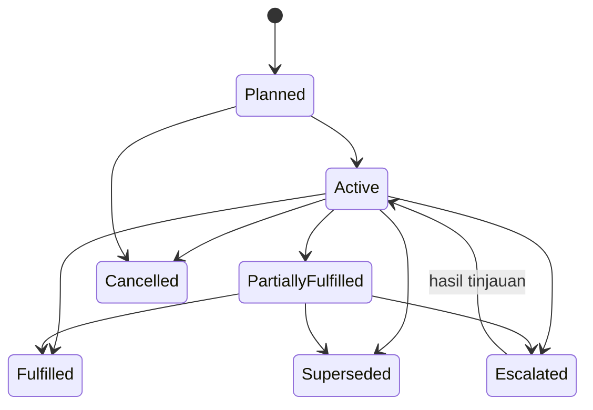

# Transisi keadaan

Kecukupan setiap snapshot dapat berupa belum dinilai, kurang, cukup, atau perlu tinjauan. Performa tetap belum ditentukan sampai kecukupan mendukung temuan terbuka atau tertutup. Evaluasi berikutnya menyimpan snapshot baru.

| Objek | Jalur utama dan guard |
| --- | --- |
| Attempt tambahan | Required → Awaiting assignment → Assigned → Scheduled → In progress → Completed → Awaiting verification → Fulfilled. Supersede dan pembatalan otomatis terbatas pada kebutuhan yang belum dikerjakan. Eskalasi dicatat bila penjadwalan atau kebijakan menghalangi pemenuhan. |
| Intervensi | Proposed atau Required → Agreed → In progress → Completed → Awaiting reassessment → Reviewed. Penetapan wajib dan asesmen ulang mengikuti kebijakan serta kewenangan. |
| Refleksi | Draft → Submitted → Reviewed. Revisi membuka versi baru dengan atribusi penulis. Persetujuan berbagi diperiksa terpisah dari status proses. |
| Konfigurasi | Draft → Published → Retired. Perubahan konfigurasi terbit dibuat sebagai revisi baru. |
| Keputusan formal | Alur terpisah sesuai kebijakan program. Periksa mandat, standar, dukungan dan alasan pada penetapan. Koreksi menambah keputusan atau catatan berotorisasi yang merujuk keputusan terdahulu. |
